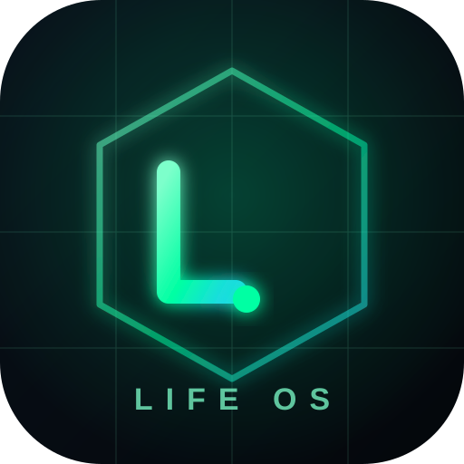
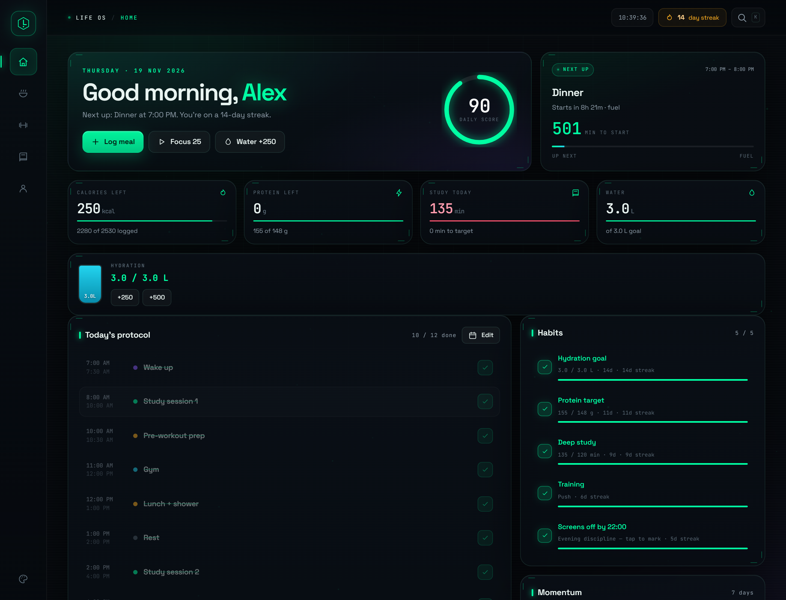
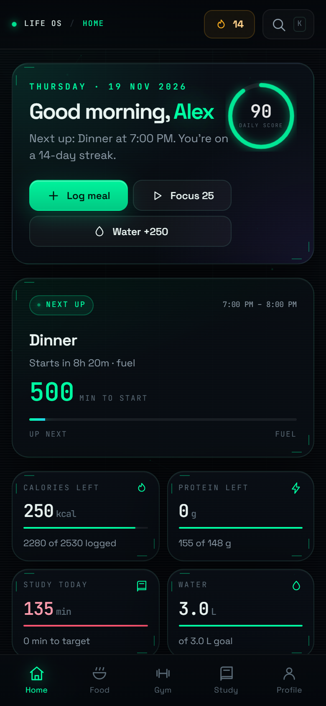
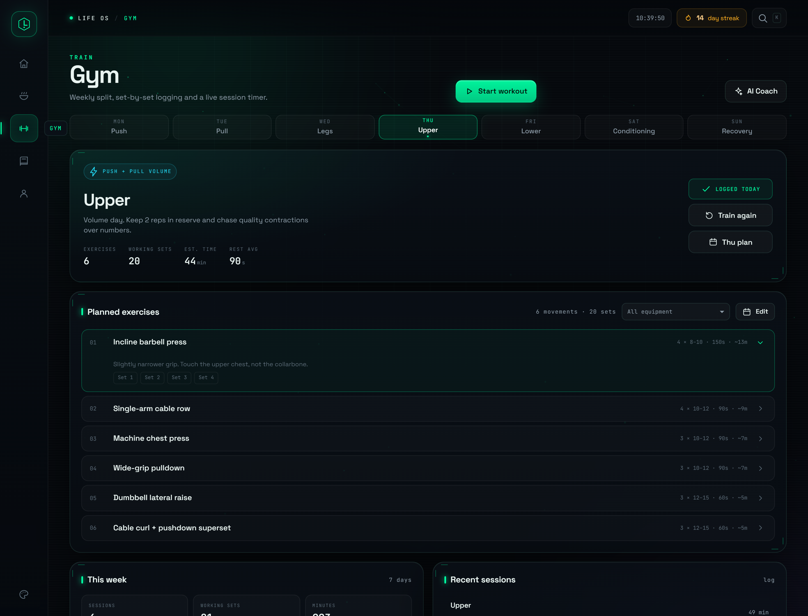
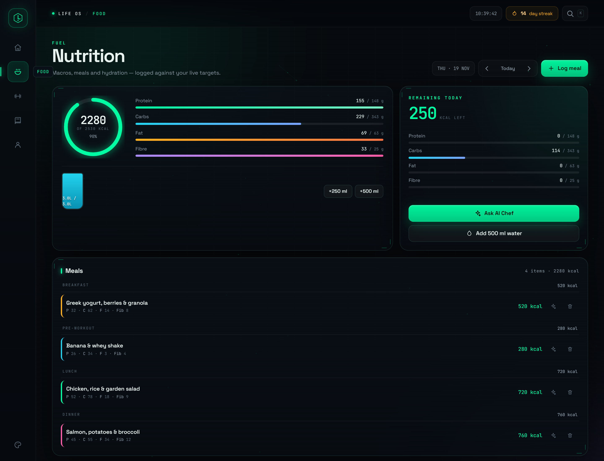

<div align="center">
  
  <h1>Life OS</h1>
  <p><strong>Focus, food, training and study — one calm dashboard.</strong></p>
  <p>A local-first operating system for your day. No account, no backend, no database.<br />Just a fast static PWA that keeps your data on your device and works offline.</p>

  <p>
    <a href="https://life-os-two-pied.vercel.app"><strong>Live demo</strong></a>
    &nbsp;·&nbsp;
    <a href="#try-the-demo">Try the demo</a>
    &nbsp;·&nbsp;
    <a href="#run-it-locally">Run it locally</a>
    &nbsp;·&nbsp;
    <a href="#how-it-works">How it works</a>
  </p>

  <p>
    <a href="https://github.com/KION6969/life-os/actions/workflows/ci.yml"></a>
    
    
    
    
  </p>
</div>



## What it does

Life OS is a single place for the parts of a day that are easy to lose track of. It
calculates your targets, shows what is left, and keeps the history without asking
you to create an account.

- **Home** — a daily score ring, the live/next schedule block, calories, protein,
  study minutes, hydration, habits and a seven-day momentum chart.
- **Food** — a macro ring, remaining macros, water tracking, a meal log by category,
  favourites and an optional AI Chef.
- **Gym** — a seven-day split, exercise notes, set-by-set logging, a rest timer,
  personal records and recent sessions.
- **Study** — Focus 25 / Deep 50 timers, a task queue, daily minutes and all-time stats.
- **Profile** — Mifflin-St Jeor BMR/TDEE, macro targets, accent and motion preferences,
  JSON export/import, storage usage and optional cloud sync.
- **Installable and offline** — a service worker caches the app shell, so it still opens
  without a network. Everything else is plain HTML, CSS and JavaScript.

> **First visit?** Choose **Explore the demo** on the welcome screen. It seeds a
> realistic week into `localStorage` so you can see the dashboard immediately. Reset
> it anytime in **Profile → Reset**.

<details>
<summary><strong>See it on a phone</strong></summary>
<br />

</details>

## The screens

| Home | Training | Food |
| --- | --- | --- |
|  |  |  |

The **Home** screen is the daily overview. **Food** handles macros, meals and water.
**Gym** runs the training plan and live session. **Study** is the focus timer and task
queue. **Profile** holds the energy model, preferences and data tools.

## Try the demo

The live site is the same static build that is in this repository.

1. Open **[life-os-two-pied.vercel.app](https://life-os-two-pied.vercel.app)**.
2. Choose **Explore the demo**.
3. Move between Home, Food, Gym, Study and Profile.

The demo does not call a server. It writes a sample profile and week of history to your
browser's `localStorage`, where a normal profile lives. **Profile → Reset** clears it.

## How it works

```
Browser
├─ index.html            app shell, screens, modals, icon sprite
├─ styles.css            design system, responsive layout, themes
├─ js/core.js            storage, derived targets, home, navigation
├─ js/food.js            macros, meals, water, AI Chef
├─ js/gym.js             split, plans, live workout, history
├─ js/study.js           timer, tasks, charts
├─ js/profile.js         profile form, energy model, data tools
├─ js/schedule.js        editable timetable
├─ js/init.js            boot, routing, palette, particles, PWA
├─ manifest.webmanifest  install metadata
└─ sw.js                 offline app shell
```

There is no build step and no runtime dependency. The app is a set of small IIFE
modules sharing a `window.LOS` namespace. State is stored under `lifeos.v1` in
`localStorage`; derived values such as BMR, TDEE, macros and water are recalculated
from the profile on every render.

The service worker is network-first for navigation and cache-first for static assets,
with a background refresh. Bump `VERSION` in `sw.js` when shipping a change that
installed copies must pick up.

## Run it locally

Clone the repo and serve the folder with any static file server:

```powershell
git clone https://github.com/KION6969/life-os.git
cd life-os
npx serve .
```

Or, if you already have Python:

```powershell
python -m http.server 4173
```

Open `http://localhost:3000` (or `http://localhost:4173`). Nothing needs to be
installed and there is no dev server to configure.

## Deploy it

This is a static site. On Vercel:

1. Import the repository.
2. Set **Framework Preset** to **Other**.
3. Leave the build command empty and the output directory as the repo root.
4. Deploy.

Or from the CLI:

```powershell
vercel --prod
```

No environment variables, secrets or database are required. `vercel.json` adds a few
security headers and keeps the service worker uncached.

## Privacy

- No analytics, no cookies, no account and no tracking pixels.
- Your profile, meals, workouts and study history stay in `localStorage` on your device.
- **Export snapshot** writes a JSON file you can keep or import later. **Reset** erases
  the local copy.
- Cloud sync is optional. If you enable it, the token you paste is stored in this
  browser and sent only to the provider you chose (GitHub Gist or JSONBin).
- The live demo does not send anything to a server.

## Tests

```powershell
npm test
```

The test suite checks that every required file and icon exists, the web manifest is
valid, every local asset referenced by `index.html` resolves, the service-worker shell
is complete, each JavaScript file parses, and no mojibake has crept into the source.
CI runs the same command on every push and pull request.

## Optional: AI Chef

The local ranking is always available and needs no network. For model-generated
suggestions, the app can call a same-origin `POST /api/chef` proxy. That proxy is not
part of the public deployment; the demo deliberately stays local and deterministic.
If the endpoint is unavailable, the local suggestions remain and nothing breaks.

## Notes

- Fonts load from Google Fonts. Without a network the system font stack is used and
  the rest of the app still works.
- The layout has a compact mode, reduced-motion support, keyboard shortcuts
  (`/` for the palette, `Alt+1…5` for screens) and labelled controls.
- Icons are an inline SVG sprite; there is no icon package to install.

## License

MIT © 2026 [KION6969](https://github.com/KION6969). See [LICENSE](LICENSE).
